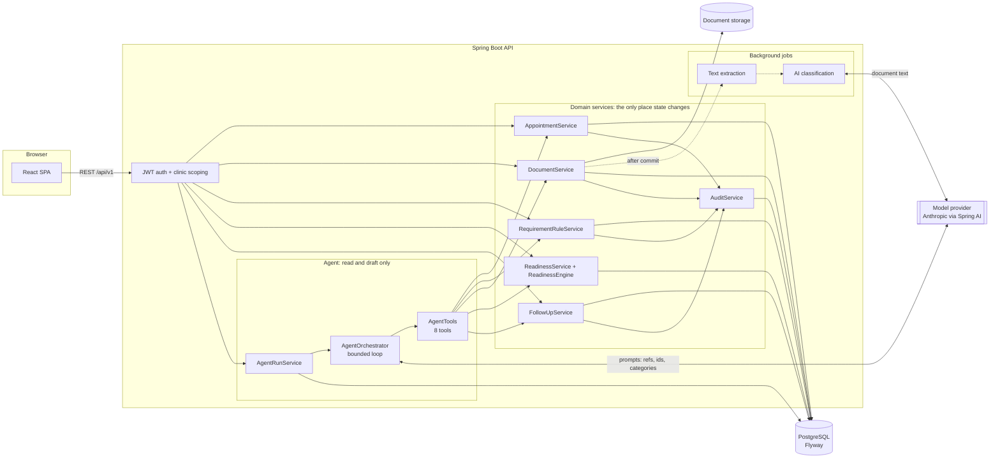

# Architecture

ClinicReady AI tells clinic staff, the day before, which appointments are administratively ready and what to do about the others.

**Core principle:** the model chooses which tools to call; Java domain services alone decide readiness, approval and execution state.

- [ERD](erd.md): every table and how they relate.
- [Agent design and safety boundaries](agent.md): tool contracts, the bounded loop, where agentic decisions happen, why the agent cannot act without approval, and two example execution traces.
- API contracts: [docs/api](../api/README.md).

## System

Approvals come only from the browser (`POST /follow-up-tasks/{id}/approve|reject`). No arrow leads from the agent to them.

## Packages

| Package | Owns |
| --- | --- |
| `security` | JWT login, current user, the role × permission matrix (`AuthorizationService`). |
| `clinic`, `patient`, `appointment` | Tenants, patients, appointments and their administrative checklist data (trusted contact, expected examinations, advance and payment confirmation). |
| `document` | Upload and versioned storage, text extraction, AI classification (an observation, never a decision), staff metadata corrections. |
| `readiness` | Requirement rules per appointment type, the deterministic `ReadinessEngine` (plain Java, no Spring, no LLM), stored results with evidence, recalculation on every input change. |
| `followup` | Follow-up tasks, the state machine and human approvals. |
| `agent` | Model access, the eight tools, agent runs and their tool calls. |
| `audit` | Append-only audit events. |

## Request flows

**Readiness.** Any change to an input (document upload or new version, metadata correction, extraction result, AI flag, administrative data, payment confirmation, requirement rule) recalculates the affected appointments in the same transaction. `GET /appointments/{id}/readiness` returns the stored result with evidence; `POST …/readiness-checks` runs it on demand.

**Agent run.** `POST /agent-runs` stores the run and returns `202`. A worker thread executes it as the initiator (same clinic, role and practitioner scope). The model calls tools; the orchestrator executes each one, stores it as an `AgentAction`, and stops at 15 calls or 90 s. The final report must be JSON and is cross-checked against stored readiness before the run succeeds.

**Follow-up.** The agent may propose a task (`AWAITING_APPROVAL`, idempotent per appointment and requirement). A receptionist or manager approves or rejects it. Only an approved task can be delivered (by staff, or by `submitApprovedAction` with that approval's id); delivery re-checks readiness. A delivered reminder satisfies no requirement.

## Tenancy and privacy

- Every tenant table carries `clinic_id`; every user-facing query filters on the authenticated user's clinic. Another clinic's record is `404`, never `403`.
- A practitioner sees only their own appointments, the patients of those appointments, and tasks and runs derived from them.
- Prompts and tool results carry patient references, ids, dates and document categories. No names, phone numbers, file names or document text reach the agent loop. Classification is the one place document text reaches a model, and it never decides readiness.
- Logs and audit summaries hold ids and field names, not values that identify a patient.
