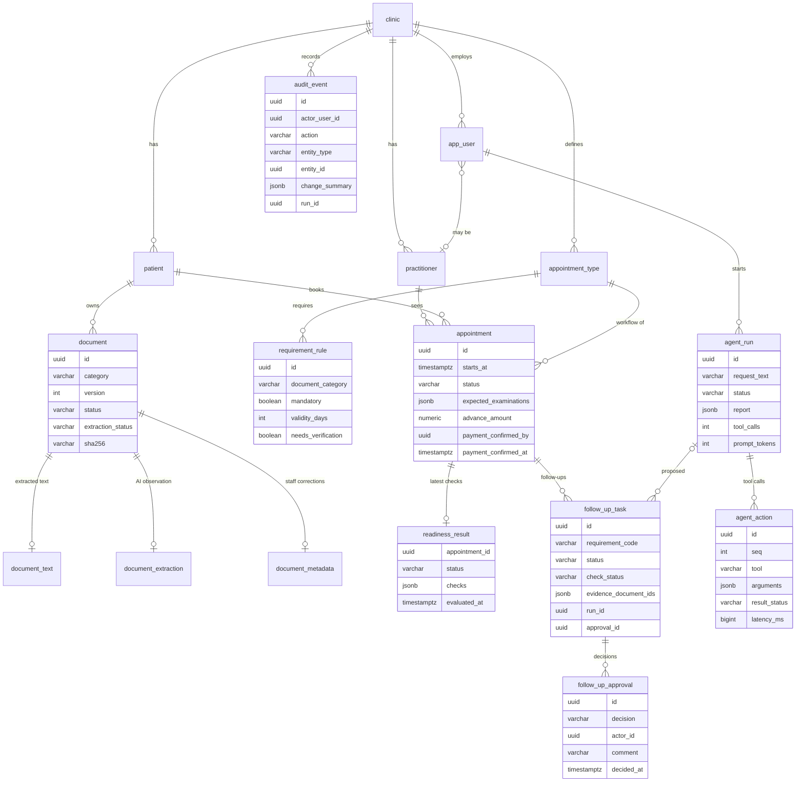

# Entity relationships

Every tenant table carries `clinic_id`. Cross-table references are composite `(id, clinic_id)` foreign keys, so the database itself refuses a row that points into another clinic. Flyway owns the schema (`backend/src/main/resources/db/migration`).

## Notes

| Table | Why it looks like this |
| --- | --- |
| `document` | One row per stored file version; a new upload of the same category is version n+1. Readiness reads the newest version per category only. |
| `document_extraction` | What a model observed. Never updated; staff corrections go to `document_metadata` and win. |
| `readiness_result` | One row per appointment, replaced on every recalculation. `checks` holds each requirement's status, reason, remaining action, document references and staff confirmations. |
| `follow_up_task` | A partial unique index allows one open task (`PROPOSED`, `AWAITING_APPROVAL`, `APPROVED`, `DELIVERED`) per appointment and requirement. Checks forbid any status past `AWAITING_APPROVAL` without `approval_id`. |
| `follow_up_approval` | Immutable human decision. A rejection must carry a comment. |
| `agent_action` | Arguments stored redacted: only known argument names (ids, dates, codes) keep their values. |
| `audit_event` | Append-only. `actor_user_id` is null for system changes. |
